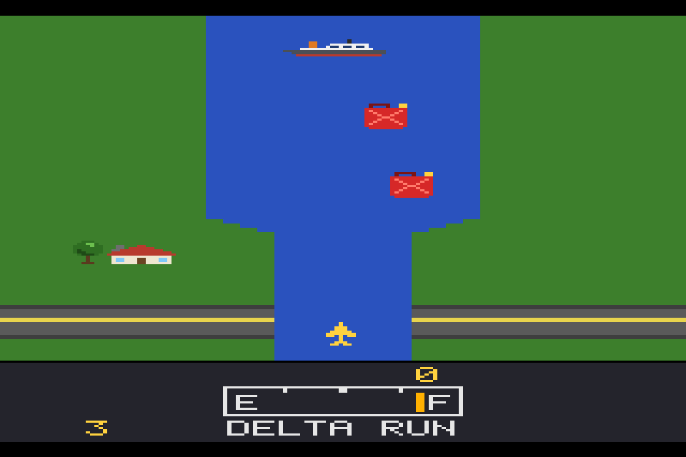
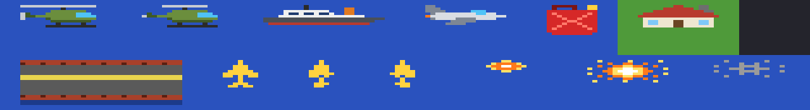

# Delta Run

A small river shooter written in Rust. Fly up a river, shoot boats,
helicopters, jets and bridges, and fly over fuel pumps before you run dry.



It is a project about rebuilding a classic kind of game from scratch in
Rust: plain structs and functions, no emulator, no engine beyond
[macroquad](https://github.com/not-fl3/macroquad) for the window and
[tinyaudio](https://github.com/mrDIMAS/tinyaudio) for sound. Everything in
it (the pictures, colours, sounds, font and the river levels) was made for
this project and is MIT licensed.

## Play it

You need Rust ([rustup.rs](https://rustup.rs)). Then:

```sh
git clone https://github.com/akaco/river-raid-rust.git
cd river-raid-rust
cargo run --release
```

Tested on macOS (Apple Silicon) and Linux. For phones and tablets see
[docs/mobile.md](docs/mobile.md). On Linux you may need the usual
window and sound libraries (`libx11-dev libxi-dev libgl1-mesa-dev
libasound2-dev` on Debian/Ubuntu). To build without sound:
`cargo run --release --no-default-features`.

| Key | Does |
| --- | --- |
| Arrows or WASD | Steer left/right, speed up (up) or slow down (down) |
| Space | Fire |
| Enter | Start a game |
| Tab | One or two players |
| 1 | Straight missiles on/off (off: missiles follow the plane) |
| P | Pause |
| M | Mute |
| T | Show the touch controls (the mouse works as a finger) |

On a phone or tablet: a pad on the left steers and changes speed, a button
on the right fires, and pause and sound are in the top corner. Game
controllers work too. [docs/mobile.md](docs/mobile.md) has the controls and how to
build for iPhone, iPad and Android.

## How to play

- Fuel goes down all the time. Fly over a fuel pump to fill up; shooting
  it gives points but no fuel.
- Hitting a bank, a boat, a helicopter, a jet or a bridge costs a plane.
- Each bridge is a checkpoint: after a crash you start again from the last
  one you blew up.
- The river gets narrower and busier further up. Islands appear from the
  second section, jets from the third.
- You get an extra plane every 10,000 points.

## How it is built

```
src/
  lib.rs      the game as a library (no window needed)
  game.rs     rules: phases, fuel, score, lives, steering, missiles
  river.rs    the river: six bands on screen, the level generator
  objects.rs  boats, helicopters, jets, fuel pumps, houses, bridges
  collide.rs  what touches what, by overlapping pixels
  screen.rs   where things are on screen, and drawing to any Canvas
  sprites.rs  reads the pictures file; the font
  touch.rs    on-screen controls: layout for any screen, the pad
assets/
  sprites.txt every picture, as letters you can edit
examples/
  sprite_sheet.rs  draws every sprite into one picture
  palette.rs  colours
  sound.rs    sound effects  ┐ our own little synthesizer:
  synth.rs    square + noise ┘ two voices
  main.rs     the macroquad window, keys, touch, audio thread
ios/          Xcode project (XcodeGen) for iPhone and iPad
vendor/       miniquad with an iOS multi-touch fix
```

The game runs at a fixed 60 frames a second and draws a 160 x 238 pixel
picture, which the window scales to fit. Because `game.rs` never touches
the window, the same code can be tested headless and run on phones.

## Change the pictures

Every picture (plane, enemies, fuel pump, house, bridge, explosions) is in
[assets/sprites.txt](assets/sprites.txt): one letter per pixel, with the
colour of each letter written above the picture. Edit it and
`cargo run --release` again; no code to change. If something in the file
is wrong, the game stops and says which line. To see every picture at
once: `cargo run --example sprite_sheet > sprites.ppm`.



[docs/how-it-works.md](docs/how-it-works.md) explains the river, the
collisions and the sound in more detail.

## Tests

```sh
cargo test --release
```

- `tests/river.rs` checks every river section the generator makes can be
  flown through, objects start on open water, and every game gets the same
  river.
- `tests/play.rs` lets a simple autopilot play 60,000 frames (about 17
  minutes) and checks it gets past the second bridge.

## Licence

MIT, see [LICENSE](LICENSE).
